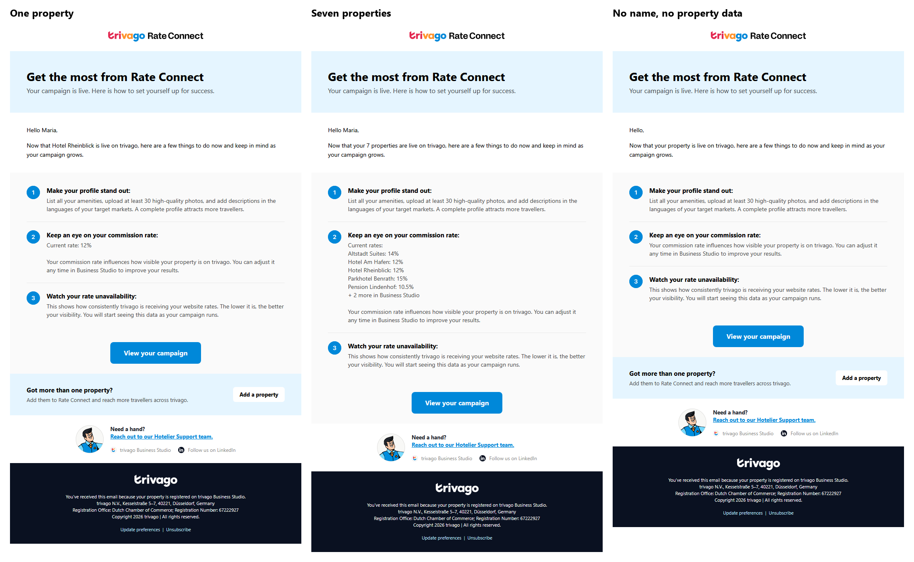

# The AMPscript: how I built it, tested it, and what I learned

The brief's bonus asked me to fill the placeholders with AMPscript (hotelier name, property name, commission rate) and to change the property content for single and multi-property hoteliers. It also said you don't expect me to run it. I wanted to know it works anyway, so I tested it four ways, and two of them found bugs that would have broken it in Marketing Cloud.



*One template, three hoteliers. These are the emails Salesforce Labs' own AMPscript engine produced from `email-ampscript.html`, opened in Chrome. Left: one property, as designed. Middle: seven properties, . Right: no name and no property data, so it says "Hello," and "your property" and leaves the rate line out.*

## What it does

| The hotelier has | Intro | Tip 2 | "Add a property" banner |
| --- | --- | --- | --- |
| One property | "Now that *Hotel Rheinblick* is live" | "Current rate: 12%" | Shown |
| Two or more | "Now that your *7* properties are live" | One line per property, A to Z, five at most, then "+ N more in Business Studio" | Hidden |
| No property data | "Now that your property is live" | Rate line left out | Shown |

No name gives "Hello," instead of "Hello ,". The full screenshots are `screenshots/ampscript/01` to `03`. `04` is a hotelier with exactly two properties, the smallest multi-property case: "your 2 properties", two rate lines, no "+ more" line and no banner. Both engines produced the same text for it.

## How I built it

Claude Code wrote the AMPscript with me. These are the decisions behind it:

- **All the logic sits in one block at the top of the file.** The HTML below it only prints variables and switches whole sentences on or off. Someone who edits the markup never has to read the logic, and every sentence stays complete, so it can be translated as a whole.
- **The data is read with `AttributeValue()`, not with personalization strings.** Salesforce's documentation says a personalization string with no matching column fails the send for that person, while `AttributeValue()` returns nothing and lets the email handle it.
- **Properties come from a second data extension, looked up by hotelier ID.** If the lookup finds nothing, the email falls back to a property name and rate on the hotelier's own row.
- **At most five rates are listed.** That keeps tip 2 short. Without a cap, about 800 properties would push the email past Gmail's 102 KB clipping limit, which hides the footer and the unsubscribe link (measured).
- **Every field is Text,** including the commission rate. The reason is under "What I found" below.
- **The table and field names are my assumptions.** They're at the top of the script, so trivago's real names go in one place. The banner rule (shown to single-property hoteliers, hidden for several) is also an assumption, and flipping it is a one-line change.

## How I tested it

### 1. My own test runner

There's no free Marketing Cloud account, so I had Claude Code build `tools/ampscript_run.py`. It runs the part of AMPscript this email uses against eleven test cases in `tests/ampscript/cases.json`: one property; seven; exactly five; a missing rate; no name and no data; data only on the hotelier's row; stray spaces in a name; no hotelier ID column; a rate of 0; umlauts in the A to Z sort; and a wrong table name. For each one it checks what the email must and must not say. Planting a bug (in the banner rule, the sort order, a function name or an `ENDIF`) makes the cases fail, so I know the checks can fail.

```
python tools/ampscript_run.py
...
11 of 11 cases pass. Outputs: tests/ampscript/out/
```

### 2. Every function checked against Salesforce's reference

A runner I build myself only proves the script does what *I think* AMPscript does. So I had Claude Code check every function and keyword in the script against Salesforce's AMPscript documentation. That found the two bugs below. After the fix, the runner fails on the first bug too, so it can't come back:

```
python tools/ampscript_run.py old-version.html
      AMPscript error: FOR counter @i was declared with VAR; Marketing Cloud rejects that
0 of 11 cases pass.
```

### 3. A second engine: Salesforce Labs' AMPscript Core

Salesforce Labs publishes an open-source AMPscript engine, AMPscript Core (Salesforce's AMPscript docs list it as a community-supported VS Code extension). It isn't Marketing Cloud and it's incomplete, but it wasn't written by me, so it doesn't share my assumptions. I installed it and ran the unchanged `email-ampscript.html` through it. It read the whole file, and the only thing it couldn't compile was one function it doesn't have yet:

```
email.ampscript(69,50): error CS1061: 'RuntimeContext' does not contain a definition for 'LOOKUPORDEREDROWS'
```

So `tools/ampscript_core_check.py` runs a test copy with two changes, both for gaps in the engine, not in the email (details under "What I found"). It runs all eleven cases and compares each result with my runner's:

```
python tools/ampscript_core_check.py ampscript-0.0.6.vsix
PASS  single: same text as the runner
PASS  multi_seven: same text as the runner
...
PASS  wrong_lookup_name: both stop with an error

11 of 11 cases agree. Outputs: tests/ampscript/core/
```

Ten cases produced word-for-word the same text in both engines and passed every check, and in the wrong-table case both stop with an error. The screenshots at the top are from this engine.

### 4. Real inboxes

The runner can also build one finished email per hotelier from a small sample database (`tests/ampscript/demo/`, two CSV files that open in Excel). I sent three of them to my own inbox: one property, a very long property name, and more than five properties. All three displayed correctly.

### What I couldn't test

Marketing Cloud itself. Every test above imitates it or reads its documentation. `README.md` ("Test it in Marketing Cloud") has the steps for someone with an account: two data extensions, two CSV imports, and Preview and Test, one row per test case.

## What I found

| What | Found by | What happened |
| --- | --- | --- |
| The multi-property preview listed the properties in a different order than the script produces | My runner | The preview had been edited by hand. The previews are now the runner's real output. |
| The loop counter `@i` was declared with `VAR` | Checking the docs | Salesforce's reference says declaring a `FOR` counter "will result in a validation or runtime error". Removed. |
| `commission_rate` was typed as Number | Checking the docs | In Marketing Cloud, Number only takes whole numbers, so a 10.5% rate would have failed the import. Now Text, which prints exactly what's stored. I didn't use Decimal because I couldn't check whether it prints 12 or 12.00. |
| The engine has no `LookupOrderedRows()` | Salesforce's engine | The test copy uses `LookupRows()` with the CSV rows already in A to Z order. |
| The engine crashes comparing a `Subtract()` result with a number | Salesforce's engine | Narrowed down to one line: `Subtract(7, 5) > 0` fails with "Unable to cast Double to Decimal". The test copy uses the same condition written without `Subtract()`. |
| The engine prints a missing field as raw text | Salesforce's engine | Salesforce's documentation says `AttributeValue()` returns nothing there, and the engine does return nothing for an empty field. A data extension row always has every column, so the test gives every hotelier all four columns. |
| The engine doesn't fill in the subscription center and unsubscribe links | Salesforce's engine | The engine doesn't support those yet. Marketing Cloud fills them in at send time. |
| The engine accepts a declared loop counter | Salesforce's engine | Salesforce's docs say Marketing Cloud doesn't, so here the docs win over the engine. |

The email itself didn't change for anything the engine found. Those are gaps in the engine, and changing a working email to suit one test tool risks breaking it, which is the same call I made with Email on Acid's Pixel phones.

## What I learned

- **A test I write myself shares my blind spots.** All eleven cases passed while both bugs were in the file, because the runner had been written from the same understanding as the script. The bugs only showed up with something independent: the official docs and someone else's engine.
- **Every tool is partial, so know what each one proves.** The runner proves the logic for my cases. The docs prove the syntax and the data types. Salesforce's engine proves another implementation reads the file the same way. A real inbox proves the output displays. Only Marketing Cloud proves all of it, and I couldn't run that.
- **Data types are part of the design.** The Number bug wasn't in the script at all; it was in the data the script expects. It would have failed at import, before any email was sent.
- **Don't fix the email for a test tool.** When the engine disagreed with the docs, I changed the test copy and wrote down why.

## Run it yourself

```bash
python tools/ampscript_run.py                                  # the eleven cases, my runner
python tools/ampscript_run.py --demo                           # one email per hotelier in tests/ampscript/demo/
python tools/ampscript_core_check.py ampscript-0.0.6.vsix      # the same cases in Salesforce Labs' engine
```

The last command needs the `.vsix` from [SalesforceLabs/ampscript-core](https://github.com/SalesforceLabs/ampscript-core/releases) (I used 0.0.6) and the .NET 8 and ASP.NET Core 8 runtimes.
